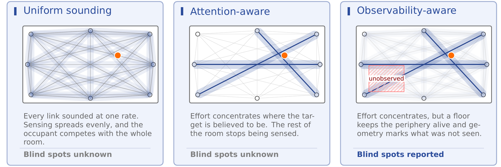
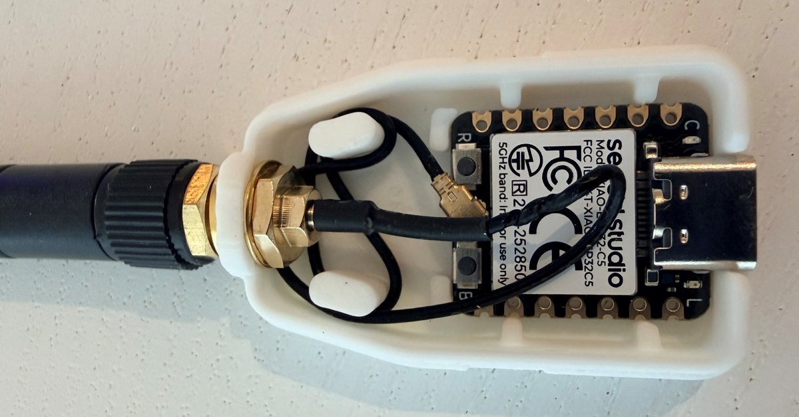
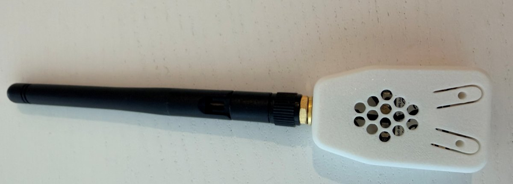
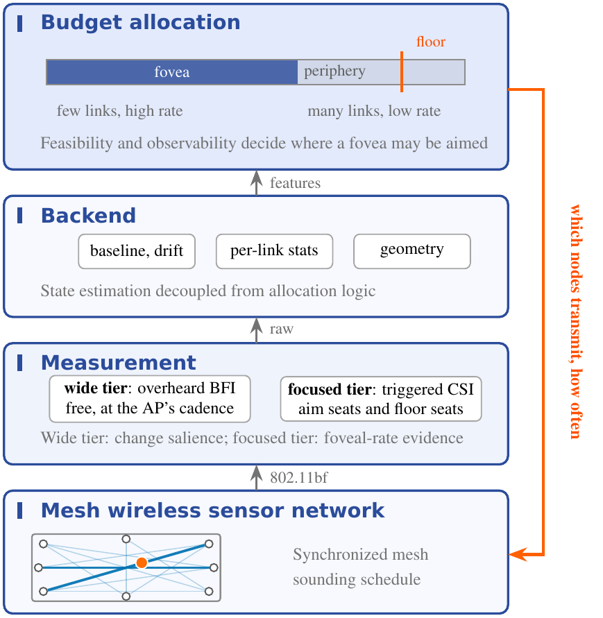

# Foveation and Observability in Wireless Sensor Networks

Code, node firmware and data behind K. Khamaisi and B. Rodrigues, "Foveation and Observability
in Next-Generation Wireless Sensing Networks", IEEE Communications Magazine (under revision).

<p align="center"></p>

A mesh of Wi-Fi nodes shares one sounding budget. Uniform sounding spreads it over every link,
so on a dense mesh no link is sampled fast enough to resolve human motion. Concentrating the
budget on the links around the occupant (foveation) recovers the rate, but the rest of the room
stops being sensed and a silence there is indistinguishable from an empty room. The approach
keeps a floor of sounding on the periphery, and computes from the node geometry where the mesh
can and cannot localize, so the system reports the regions it could not have observed (Fig. 2 of
the article).

| Folder | What it is |
|---|---|
| `firmware/` | The node firmware (v5.9.1, ESP32-C5 and ESP32-C3, ESP-IDF 5.4.1): triggered CSI sounding and overheard beamforming reports. |
| `controller/` | The host side of the two-tier design: the firmware's wire protocol, a node controller that runs the sounding cycle, the seat allocator of the focused tier (Sec. IV) and the absence release of the case study (Sec. V). |
| `scripts/` | The analysis behind every figure and quoted number (Secs. III to V). |
| `data/`, `reference/` | Inputs, and the outputs the article was written from. |
| `tests/` | Tests for all of the above. |

<p align="center">
  
  
</p>
<p align="center"><em>An ESP32-C5 node: a Seeed Studio XIAO ESP32-C5 in a printed enclosure, open (left)
and closed with its external 2.4/5 GHz antenna (right).</em></p>

## Run a mesh

<p align="center"></p>
<p align="center"><em>The layers the code implements (Fig. 1 of the article): the firmware is the mesh
and the measurement tiers, the controller is the allocation and the return path that tells the
radios which nodes transmit and how often.</em></p>

1. Build and flash `firmware/` on two or more ESP32-C5 or ESP32-C3 boards (`firmware/README.md`).
2. On a host on the same network:

```
cd controller
python node_controller.py --duration 60 --out csi.jsonl                       # uniform rotation
python node_controller.py --mode focus --aim "MAC1|MAC2" --door "MAC1|MAC3"  # focused tier
```

The controller broadcasts DISCOVER, registers every node that answers, and then triggers one
transmitter per 20 ms slot. In focus mode each 10 s bin it seats the aim chord and rotates the
floor through a pool that starts from the door chords and covers every node, inside an envelope
of six transmitters (`--envelope`). It writes one JSON line per CSI sample and per overheard
beamforming report, and prints the links it heard. The wide tier needs nothing from the host:
nodes forward the beamforming reports of the access point's clients as they overhear them.

`controller/schedule.py` and `controller/release.py` are extracts of the deployed watcher. The
allocator test replays a directive the deployment recorded on 8 September 2026
(`tests/fixtures/`, node identifiers replaced by pseudonyms in the same sort order), and the
release replay matches the logged absence score in every bin of the hold.

## Data

- `data/positions.json`: the ten node positions in metres, from the mesh's own position solver
  (not a survey), keyed by the last two bytes of each node's MAC address, as printed in Fig. 4.
- `data/episode.json`: the evening of 4 August 2026, 19:00 to 23:00 local time (UTC+2), one row
  per 10 s bin, as plotted in Fig. 5: `p_present` the presence belief, `reported_occupied` the
  reported state, `z_roll` the movement statistic, `s_absence` the absence score.
- `data/episode_inputs.jsonl`: the same evening with every input of the release rule, one row per
  10 s bin: `z_roll` (CSI), `z_mesh`, `bfi_agitation_z` and `bfi_n_reporting` (BFI),
  `sounding_density` (device traffic), `illuminated` (an active probe), `event`, and the logged
  `s_absence` and `absence_reason`.

Two inputs come from the deployment and are not regenerated here: the signal and noise levels in
`scripts/model.py` (0.072 and 0.039, measured over a 144-minute confirmed-empty run and an occupied run),
and the adaptive-focus airtime shares of Sec. III-B (0.25 and 0.41, from the 19 July 2026 logs).

## License

Code and firmware: MIT (`LICENSE`). Data: CC BY 4.0.
