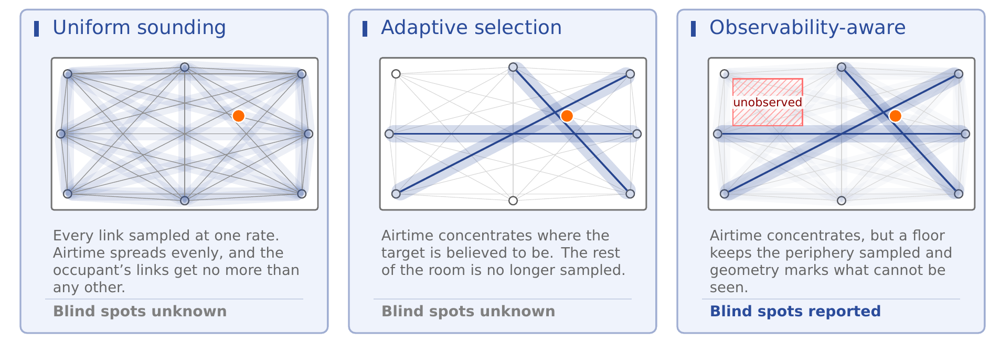
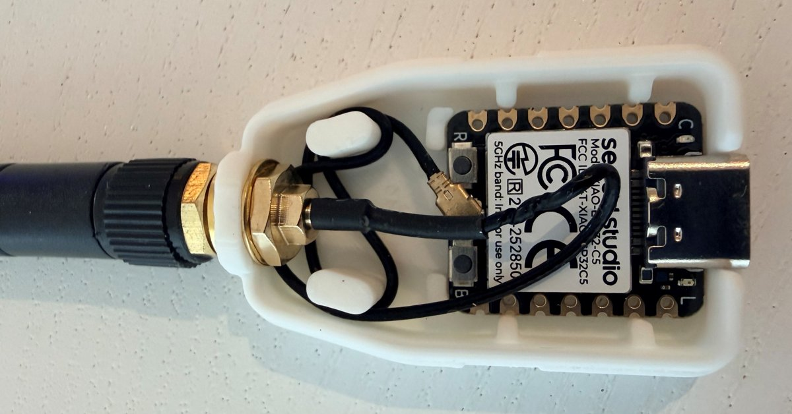
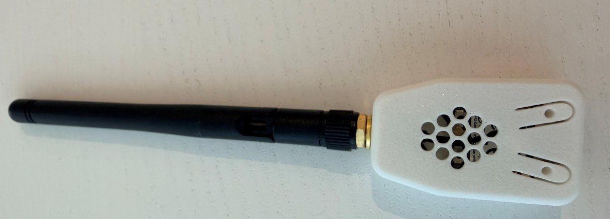
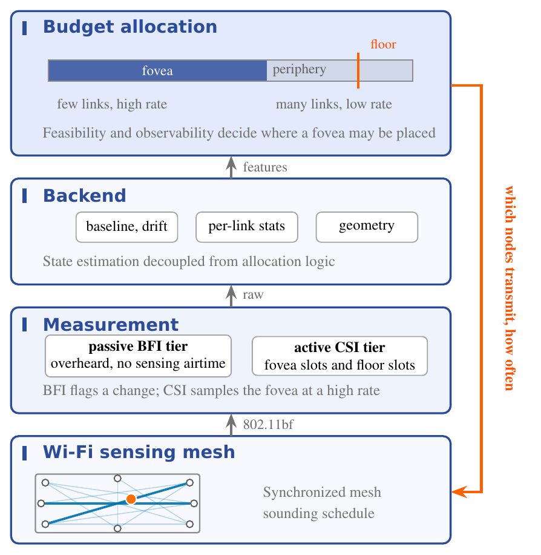

# Foveation and Observability in Next-Generation Wireless Sensing Networks

Code, node firmware and data behind K. Khamaisi and B. Rodrigues, "Foveation and Observability
in Next-Generation Wireless Sensing Networks", IEEE Communications Magazine (under revision).

<p align="center"></p>

A mesh of Wi-Fi nodes shares one sounding budget. Uniform sounding spreads it over every link,
so on a large mesh no link is sampled fast enough to capture human motion. Concentrating the
airtime on the links around the occupant (the fovea) recovers the sampling rate, but the rest of
the room (the periphery) is sampled less, and silence there cannot be told apart from an empty
room. The approach keeps a periphery floor of sounding on all other nodes, and computes from the
node geometry where the mesh can locate or detect a person (the observability field), so the
system reports the regions it cannot observe as unknown (Fig. 2 of the article).

| Folder | What it is |
|---|---|
| `firmware/` | The node firmware (v5.9.1, ESP32-C5 and ESP32-C3, ESP-IDF 5.4.1): triggered CSI sounding and overheard beamforming reports. |
| `controller/` | The host side of the two-tier design: the firmware's wire protocol, a node controller that runs the sounding cycle, the fovea and floor allocation of the active CSI tier (Sec. IV) and the absence release of the case study (Sec. V). |
| `scripts/` | The analysis behind every figure and quoted number (Secs. III to V). |
| `data/`, `reference/` | Inputs, and the outputs the article was written from. |
| `tests/` | Tests for all of the above. |

<p align="center">
  
  
</p>
<p align="center"><em>An ESP32-C5 node: a Seeed Studio XIAO ESP32-C5 in a printed enclosure, open (left)
and closed with its external 2.4/5 GHz antenna (right).</em></p>

## Run a mesh

<p align="center"></p>
<p align="center"><em>The layers the code implements (Fig. 1 of the article): the firmware is the mesh
and the measurement tiers, the controller is the allocation and the return path that tells the
radios which nodes transmit and how often.</em></p>

1. Build and flash `firmware/` on two or more ESP32-C5 or ESP32-C3 boards (`firmware/README.md`).
2. On a host on the same network:

```
cd controller
python node_controller.py --duration 60 --out csi.jsonl                       # uniform rotation
python node_controller.py --mode focus --aim "MAC1|MAC2" --door "MAC1|MAC3"  # focused tier
```

The controller broadcasts DISCOVER, registers every node that answers, and then triggers one
transmitter per 20 ms slot (50 triggers per second). In focus mode, every 10 s bin it gives fovea
slots to the endpoints of the target link (`--aim`) and rotates the floor slots through a set of
nodes that starts from the doorway links (`--door`) and covers every node, with at most six
transmitters per bin (`--envelope`). It writes one JSON line per CSI sample and per overheard
BFI report, and prints the links it heard. The passive BFI tier needs nothing from the host:
nodes forward the BFI reports of the access point's clients as they overhear them.

`controller/schedule.py` and `controller/release.py` are extracts of the deployed watcher. The
allocator test replays a directive the deployment recorded on 8 September 2026
(`tests/fixtures/`, node identifiers replaced by pseudonyms in the same sort order), and the
release replay matches the logged absence score in every bin of the hold.

## Data

- `data/positions.json`: the ten node positions in metres, from the mesh's own position solver
  (not a survey), keyed by the last two bytes of each node's MAC address, the circles in Fig. 3.
- `data/episode.json`: 4 August 2026, 19:00 to 23:00 local time (UTC+2), one row
  per 10 s bin, as plotted in Fig. 5: `p_present` the occupancy estimate, `reported_occupied` the
  reported state, `z_roll` the CSI motion statistic, `s_absence` the absence score.
- `data/episode_inputs.jsonl`: the same recording with every input of the release rule, one row per
  10 s bin: `z_roll` (CSI), `z_mesh`, `bfi_agitation_z` and `bfi_n_reporting` (BFI),
  `sounding_density` (device traffic), `illuminated` (an active probe ran in this bin), `event`, and the logged
  `s_absence` and `absence_reason`.

Two inputs come from the deployment and are not regenerated here: the signal and noise levels in
`scripts/model.py` (0.072 and 0.039, measured over a 144-minute confirmed-empty run and an occupied run).

`docs/technical_note.md` gives the models, parameters and derivations behind every figure and
number of the article, and the script that produces each one.

## License

Code and firmware: MIT (`LICENSE`). Data: CC BY 4.0.
